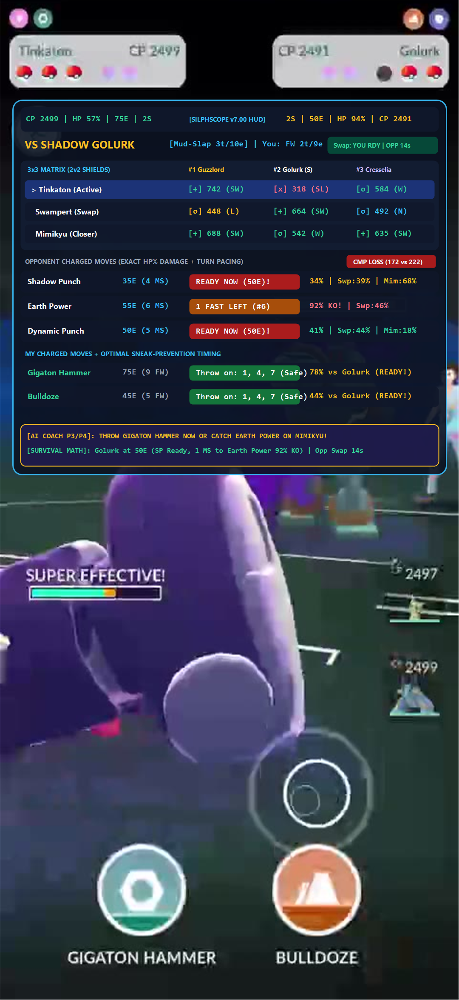
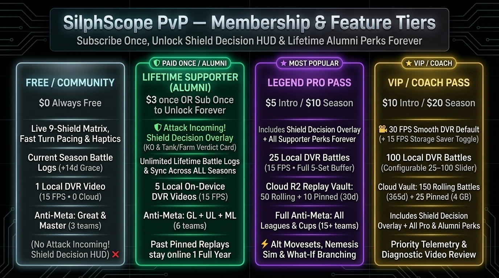
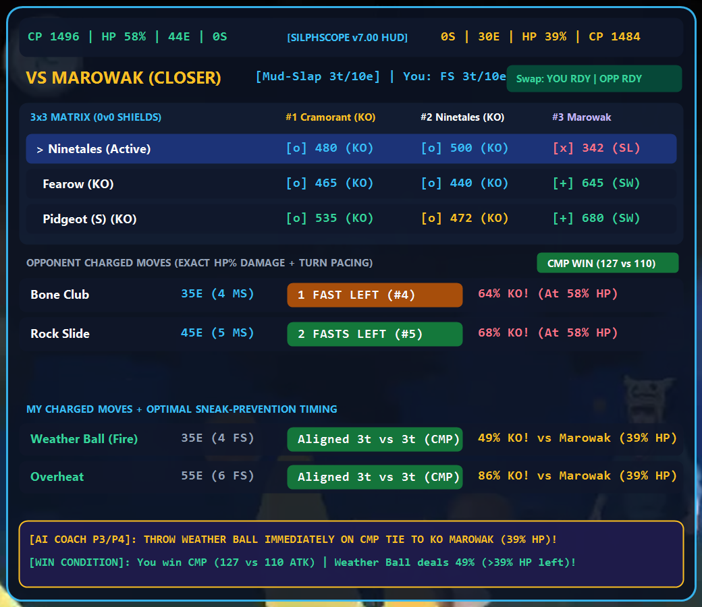
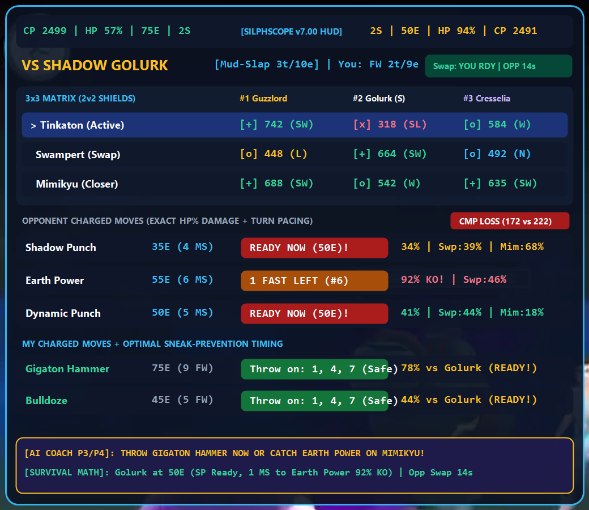

# SilphScope PvP — Real-Time 3x3 Matchup Matrix, Damage Calculations, Turn Pacing HUD & Battle Log Overlay for Pokémon GO PvP (v7.24)

[](https://silphscopepvp.com)
[](https://dl.silphscopepvp.com)
[](https://dvr.silphscopepvp.com/vault)
[](https://buy.stripe.com/14A4gAcVjf8491P8ee1Jm09)
[](https://buymeacoffee.com/silphscopepvp)

---



**SilphScope PvP** is a standalone Android application and client-side web battle simulator for **Pokémon GO Battle League (GBL)** and **Show 6 (Battle Frontier)**. Built with Kotlin, WindowManager `TYPE_APPLICATION_OVERLAY`, in-memory `MediaProjection` frame analysis (zero disk writes), hardware H.264 DVR + Cloud R2 Replay Vault, PvPoke `gamemaster.json` + official league rankings JSON synchronization, offline Google ML Kit Text Recognition, Battle Quality & Wins Above Expected (WAE) micro-skill analytics, multi-device GitHub Cloud Delta Sync, and an interactive React web dashboard.

> 🛠️ **Developer & Agent Guides**: See [`CONTRIBUTING.md`](./CONTRIBUTING.md) for local build & development instructions, and [`ANTIGRAVITY.md`](./ANTIGRAVITY.md) for complete agent architecture, subsystem specifications, and full historical design logs.

---

## 🏆 Membership Tiers & Cloud Replay Vault (`v7.10`)

The **real-time floating HUD overlay, 9-shield matrix, fast-move turn pacing, and synchronized haptics are 100% Free forever**. Unlocking **🏅 Lifetime Supporter (`$2` once — or automatically forever when you subscribe to Legend Pro or VIP once)** adds the **🛡️ Attack Incoming! Shield Decision Overlay (KO & Tank/Farm Verdict Card)**, 5 local DVR videos, Open Ultra League Anti-Meta, and unlimited lifetime battle log history, while **Legend Pro** (`$3/mo` or `$6/Season` = `$2/mo` effective) and **VIP / Coach** (`$5/mo` or `$10/Season` = `$3.33/mo` effective) add Cloud R2 DVR Replay Vaults, full Anti-Meta role synthesis, and VIP **`30 FPS Smooth`** DVR recording:



| Feature / Capability | 🆓 Free Community (`$0`) | 🏅 Lifetime Supporter (`$2` One-Time or Alumni) | 🏆 Legend Pro (`$3/mo` or `$6/Season`*) | 👑 VIP / Coach (`$5/mo` or `$10/Season`*) |
| :--- | :---: | :---: | :---: | :---: |
| **Live In-Game HUD, 9-Shield Matrix & Haptics** | ✅ **100% Free** | ✅ **100% Free** | ✅ **100% Free** | ✅ **100% Free** |
| **🛡️ Attack Incoming! Shield Decision Overlay** | — | ✅ **Unlocked Forever** | ✅ **Unlocked Forever** | ✅ **Unlocked Forever** |
| **Battle Log History & Multi-Device Sync** | Current Season (+14d grace) | **Unlimited Lifetime** | **Unlimited Lifetime** | **Unlimited Lifetime** |
| **Local On-Device DVR Ring Buffer** | **1 Battle** | **5 Battles** | **25 Battles (5 Sets)** | **25–100 Battles (Slider)** |
| **Hardware H.264 DVR Video Framerate** | 15 FPS (`720 kbps`) | 15 FPS (`720 kbps`) | **15 FPS (`720 kbps` • ~14 MB)** | **🎥 30 FPS Smooth (`900 kbps` • <=30 MB max) + 💾 15 FPS Storage Saver** |
| **Cloud R2 Video & Frame Trace Vault** | — | Keeps Pinned 365d | **50 Rolling + 10 Pinned** | **150 Rolling (365d) + 25 Pinned** |
| **Anti-Meta Team Generator Leagues** | Great & Master League | **Core 3 (GL + UL + ML)** | **All Leagues + Limited/Mega Cups** | **All Leagues + Limited/Mega Cups** |
| **Anti-Meta Teams & ⚡ Alt Moveset Synthesis** | 1 / Archetype (Std Moves) | 2 / Archetype (Std Moves) | **Top 5 / Arch + ⚡ Alt Movesets** | **Top 5 / Arch + ⚡ Alt Movesets** |
| **🎯 Nemesis Analyzer & 🌿 What-If Branching** | Preview | Preview | ✅ **Full Access** | ✅ **Full Access + Priority** |

> 💡 **\*Day 15+ First-Season Promo**: Joining **Legend Pro** or **VIP** on **Day 15 or later** of a GBL Season charges only the **1-month rate (`$3` Pro / `$5` VIP)** for the **entire remainder of the current GBL season** (one-time per unique Trainer ID). Plus, subscribing to Pro or VIP even once permanently unlocks **🏅 Lifetime Supporter (Alumni)** benefits forever!
> - **Stripe Instant Checkout**: [🏅 $2 Lifetime Supporter](https://buy.stripe.com/4gM3cwf3r8JG7XLamm1Jm07) • [🏆 $3 Pro First-Season Promo](https://buy.stripe.com/14A4gAcVjf8491P8ee1Jm09) • [🏆 $6 Pro 90d Season Pass](https://buy.stripe.com/8x2aEY8F33pma5TgKK1Jm08) • [👑 $5 VIP First-Season Promo](https://buy.stripe.com/4gM7sM5sR5xudi5amm1Jm0c) • [👑 $10 VIP 90d Season Pass](https://buy.stripe.com/9B6fZi3kJ6By4Lzamm1Jm0b)
> - **Buy Me a Coffee (💰 PokéCoins & Memberships)**: [https://buymeacoffee.com/silphscopepvp](https://buymeacoffee.com/silphscopepvp)

---

## 📸 Real Android Application Screenshots & In-Game HUD (`v6.50` / `v7.00` DVR Captures)

| Main App & Presets Manager | Great League Endgame HUD (Ninetales vs Marowak) | Ultra League HUD (Tinkaton vs Shadow Golurk) |
| :---: | :---: | :---: |
|  |  |  |

- **Main App & Presets Manager (Left)**: Floating overlay controller, PvPoke + Rankings sync status, move count basis toggles, `50%–100%` overlay scaler, background glass transparency slider, and drag-and-drop persistent league team presets.
- **Master League In-Game HUD (Center)**: Real-time damage calculations for Kyogre vs Zacian (Crowned), shield scenarios, move energy cycles, and CMP tie alerts.
- **Ultra League In-Game HUD (Right)**: Turn pacing, safe move timing windows, catch point recommendations, and team switch damage previews.

---

## 🎮 Try the Live Web Simulator (No Install Needed)

Experience **SilphScope PvP** instantly in your web browser — completely free, client-side, and consuming **0 personal API tokens**:

👉 **[Launch Official Website & Live Web Simulator — https://silphscopepvp.com](https://silphscopepvp.com)** (Direct Simulator: [https://silphscopepvp.com/?view=app](https://silphscopepvp.com/?view=app) • HUD Guide: [https://silphscopepvp.com/?view=guide](https://silphscopepvp.com/?view=guide) • Compare vs PvPoke & GOBattleLog: [https://silphscopepvp.com/?view=compare](https://silphscopepvp.com/?view=compare))

- **Explore 3v3 Matchup Matrices**: Compare damage percentages, 0S / 1S / 2S shield scenarios, and CMP tie outcomes for any team.
- **Custom Team Builder with Live Autocomplete**: Pre-populated with the **PvPoke Top 3 rated Pokémon** for Great League, Ultra League, Master League, and Mega Master League. Typing a base Pokémon name automatically surfaces all Base, Shadow, Regional (Alolan/Galarian/Hisuian/Paldean), and Alternate/Mega forms in a live pop-down menu.
- **Official PvPoke Rankings Move Engine**: Synchronizes `gamemaster.json` alongside official PvPoke league rankings JSONs (`1500`, `2500`, `10000`, and `mega/10000`) to automatically assign meta-recommended Fast and Charged moves by usage.
- **Battle Quality & Wins Above Expected (WAE) Analytics**: Evaluates your micro-execution skill independent of team-composition counter-luck with Expected Win Probability ($P_{\text{win}}$), Residual Quality Delta ($\Delta Q$), 6 performance badges, and filter-reactive WAE summary metrics.

---

## Advanced Analytics & Quality Metrics (v7.22)

Raw win rate in GO Battle League is heavily influenced by matchmaking alignment and blind 3v3 team-composition luck (RPS). **SilphScope PvP v3.00** separates **Matchup Luck (Blind Matchup Favorability — BMF)** from **Dynamic Execution WAE (Wins Above Expected)** so you can track both matchmaking favorability and your in-battle micro-execution skill (energy farming, fast move denial, sacrificial catches, shield discipline, and CMP timing).

### 1. Asymmetric Shield Matrix Evaluation ($0\text{v}0$ through $2\text{v}2$)

For any active head-to-head pairing $(\text{userActive}, \text{oppActive})$, `evaluatePvPokeMatchupRating(myMon, oppMon, sUser, sOpp, league)` computes a PvPoke-calibrated $0\text{–}1000$ battle rating ($500 = \text{Neutral}$, $>500 = \text{Favorable}$, $<500 = \text{Negative}$) across all **9 discrete shield permutations** $(s_{\text{user}}, s_{\text{opp}}) \in \{0, 1, 2\}^2$:

$$\mathcal{S} = \{0\text{v}0,\; 0\text{v}1,\; 0\text{v}2,\; 1\text{v}0,\; 1\text{v}1,\; 1\text{v}2,\; 2\text{v}0,\; 2\text{v}1,\; 2\text{v}2\}$$

Each state models unblocked charged-move pressure against the defender's remaining shields ($s_{\text{def}} \in \{0, 1, 2\}$), fast-move effectiveness weighted by average shield depth, Shadow bulk adjustments, and a direct asymmetric shield-advantage delta when $s_{\text{user}} \neq s_{\text{opp}}$.

### 2. Blind Matchup Favorability ($M = 0.40 \cdot S_{\text{lead}} + 0.60 \cdot S_{\text{back}}$)

**Blind Matchup Favorability (BMF / $P_{\text{pre}}$)** measures pre-match 3v3 lineup favorability before any swaps, catches, or baits occur:

- **Lead Score ($S_{\text{lead}}$ — $50/50$ $1\text{v}1$ & $2\text{v}2$ Split)**:
  Blends the symmetric $1\text{v}1$ and $2\text{v}2$ shield scenarios equally to prevent bait-tree distortions and reflect standard lead gameplay:
  $$S_{\text{lead}} = 0.50 \cdot \text{Rating}_{1\text{v}1}(\text{myLead}, \text{oppLead}) + 0.50 \cdot \text{Rating}_{2\text{v}2}(\text{myLead}, \text{oppLead})$$
- **Backline Score ($S_{\text{back}}$ — $70/30$ Optimal Alignment Weighting)**:
  Evaluates the two possible $1\text{v}1$ backline pairings ($\text{Score}_A$ and $\text{Score}_B$) and weights the stronger alignment at $70\%$ and the weaker alignment at $30\%$:
  $$S_{\text{back}} = 0.70 \cdot \max(\text{Score}_A, \text{Score}_B) + 0.30 \cdot \min(\text{Score}_A, \text{Score}_B)$$
- **Composite Score ($M$) & Logistic Pre-Match Win Probability ($P_{\text{pre}}$ / Matchup Luck)**:
  $$M = 0.40 \cdot S_{\text{lead}} + 0.60 \cdot S_{\text{back}}, \qquad P_{\text{pre}} = \frac{1}{1 + e^{-0.006 \cdot (M - 500)}}$$
- **Aggregate Matchup Luck**:
  $$\text{Matchup Luck} = \frac{\sum_{i \in \text{Filtered}} w_i \cdot P_{\text{pre}, i}}{\sum_{i \in \text{Filtered}} w_i} \times 100\%$$

### 3. Dynamic Execution WAE with Timeline Duration Weighting ($\sum \tau_k \cdot R_k$)

When a match has recorded timeline events (`SWAP`, `SHIELD`, `FAINT`), `calculateDynamicExecutionWAE` partitions the battle into active head-to-head intervals $k$ bounded by swap and faint timestamps:

- **Duration-Weighted Execution Rating ($S_{\text{actual}}$)**:
  For each interval $k$ with duration $\Delta t_k$ and fractional weight $\tau_k = \frac{\Delta t_k}{t_{\text{total}}}$, the engine resolves the asymmetric shield rating $R_k = \text{Rating}_{s_{\text{user},k}\text{v}s_{\text{opp},k}}(\text{userActive}_k, \text{oppActive}_k)$ using the live shield counts at that moment:
  $$S_{\text{actual}} = \sum_{k} \tau_k \cdot R_k, \qquad P_{\text{exec}} = \frac{1}{1 + e^{-0.006 \cdot (S_{\text{actual}} - 500)}}$$
  *(If timeline events are absent, such as manual or legacy entries, $P_{\text{exec}}$ gracefully falls back to $P_{\text{pre}}$.)*
- **Base Execution Residual ($\Delta Q_{\text{base}}$)**:
  $$\Delta Q_{\text{base}} = \text{Result} - P_{\text{exec}}, \qquad \text{Result} \in \{0.0, 1.0\}$$
- **Faint Margin Scaling ($\times 1.10$)**:
  If $\text{Result} = 1.0$ and $(\text{oppFaints} - \text{userFaints}) \ge 2$, positive execution credit is scaled by $1.10\times$:
  $$\Delta Q_{\text{scaled}} = 1.10 \cdot \Delta Q_{\text{base}}$$
- **Shield-in-Pocket Penalty ($-0.15$ per unused shield)**:
  If $\text{Result} = 0.0$ and $\text{userShieldsRemaining} > 0$, unspent defensive resources are penalized:
  $$\Delta Q_{\text{final}} = \Delta Q_{\text{scaled}} - 0.15 \cdot \text{userShieldsRemaining}$$
- **Aggregate Execution WAE**:
  $$\text{EXEC WAE} = \frac{\sum_{i \in \text{Filtered}} w_i \cdot \Delta Q_{\text{final}, i}}{\sum_{i \in \text{Filtered}} w_i} \times 100\%$$

### 4. Handling of Unrevealed Pokémon (Early Forfeits & Sweeps)

| Opponent Lineup Seen | Confidence Weight ($w$) | Evaluation Behavior |
| :--- | :---: | :--- |
| **Missing 2nd Slot (`firstSwap` null/missing)** | $w = 0.00$ | **Dropped / Unranked (`quality: null`)**: Early forfeits or incomplete scans where the opponent's switch was never revealed are excluded from ranked `EXEC WAE` and `MATCHUP LUCK`. |
| **Unrevealed 3rd Slot (`finalSeen` null/missing)** | $w = 0.75$ | **75% Confidence Meta-Prior (`⚡ 75% Conf`)**: Substitutes the unweighted average $1\text{v}1$ ratings of `mySwap` ($\bar{R}_{\text{swap}}$) and `myClose` ($\bar{R}_{\text{close}}$) against the active league's top meta pool: $\text{Score}_A = \frac{R_{1\text{v}1}(\text{mySwap}, \text{oppSwap}) + \bar{R}_{\text{close}}}{2}$, $\text{Score}_B = \frac{R_{1\text{v}1}(\text{myClose}, \text{oppSwap}) + \bar{R}_{\text{swap}}}{2}$. |
| **All 3 Opponents Revealed** | $w = 1.00$ | **Full 3v3 Evaluation**: Exact pairwise $1\text{v}1$ backline matrix evaluation at $100\%$ confidence weight. |

### 5. Badge Glossary (6 Primary Performance Badges & 5 Contextual Event Pills)

Primary performance badges are derived from Pre-Match BMF ($P_{\text{pre}}$) and the match outcome, accompanied by contextual timeline/end-state pills:

| Outcome | Pre-Match BMF ($P_{\text{pre}}$) | Primary Badge | Color Hex | Tactical Meaning |
| :---: | :---: | :--- | :---: | :--- |
| **WIN** | $P_{\text{pre}} < 0.40$ | **`Clutch Win`** | Cyan `#22d3ee` | Flipped a heavily unfavorable team alignment via superior micro-execution (catches, energy lead, or shield baiting). |
| **WIN** | $0.40 \le P_{\text{pre}} \le 0.60$ | **`Skill Win`** | Bright Green `#4ade80` | Out-executed the opponent in an even/neutral 3v3 matchup. |
| **WIN** | $P_{\text{pre}} > 0.60$ | **`Expected Win`** | Muted Slate `#94a3b8` | Cleanly converted a favorable team-composition advantage into a win. |
| **LOSS** | $P_{\text{pre}} > 0.60$ | **`Blunder Loss`** | Rose Red `#f43f5e` | Dropped a favorable matchup where your 3v3 lineup had $>60\%$ pre-match win equity. |
| **LOSS** | $0.40 \le P_{\text{pre}} \le 0.60$ | **`Tough Loss`** | Orange `#fb923c` | Narrow loss in a competitive 50/50 matchup. |
| **LOSS** | $P_{\text{pre}} < 0.40$ | **`Expected Loss`** | Muted Slate `#94a3b8` | Hard-countered team composition ($<40\%$ win equity); minimal negative impact on WAE. |

**Contextual Event Pills**:
- **`⚠️ Double Shield Pocket`**: Loss with 2 unused shields remaining ($-0.30$ $\Delta Q$ penalty).
- **`⚠️ Shield in Pocket`**: Loss with 1 unused shield remaining ($-0.15$ $\Delta Q$ penalty).
- **`🧹 Clean Sweep`**: Win achieved with 0 user faints (all 3 Pokémon surviving).
- **`🛡️ Shield Advantage`**: Win ending with more shields remaining than the opponent.
- **`⚡ 75% Conf`**: Opponent's 3rd Pokémon was unrevealed; evaluated at $w = 0.75$ confidence weight using the league meta-average prior.

---

## 🖼️ HUD & Feature Overview


---

## ☕ Support Continued Development

If **SilphScope PvP** helps you count fast moves, win CMP ties, and climb Elo in GO Battle League, consider supporting continued updates and new feature releases:

👉 **[Buy Me a Coffee — https://buymeacoffee.com/sportsfan986](https://buymeacoffee.com/sportsfan986)**

---

## 📥 Download & Install Native Android APK (v7.22)

> **✅ Note on Live HP & Energy Counting (Enabled by Default since v6.02)**:
> **❤️ Live HP Bar Tracking** and **⚡ Live Energy & Fast-Move Counting** are **ENABLED (ON)** by default with optimal scanner tuning (`2 samples`, `±2%` tolerance, `200ms` proactive energy lead, `+1t` fast offset, and `4.0s` swap-throw rollback). You can customize all scanner, haptics, and Always-On DVR controls in **⚙️ Settings**.

1. Visit the **[Official GitHub Releases Page](https://github.com/sportsfan986/silphscope-pvp/releases)**.
2. Download **`silphscope-pvp-v7.22.apk`** directly to your Android device.
3. Tap the downloaded APK file to install (grant *"Install unknown apps"* permission if prompted).
4. Launch **SilphScope PvP**:
   - Select, reorder, or customize your **GBL or Show 6 Team Presets**, set **Opponent Move Count Basis** (`My Fasts` vs. `Their Fasts`), adjust **Overlay Size** (`50%–100%` screen width slider) and **Background Transparency**, and configure **Synchronized Haptics** or **1-Battle DVR** in **⚙️ Settings**.
   - Grant **"Display over other apps"** (Floating Window permission) and **Screen Capture** permission (used strictly in-memory for ML Kit OCR and optional 1-Battle hardware DVR).
   - Tap **"Start Battle Overlay"** (or trigger via Tasker intent hooks) and launch Pokémon GO!
   - **Tip**: Tap the top-left overlay icon to minimize/pause OCR, or **press and hold the top-left icon for 2 seconds** when expanded to immediately stop the overlay and open the **📜 Battle Log** in the main app.

---

## ✨ Changelog — Complete Release History (`v1.00` – `v6.26`)

*(See [CHANGELOG.md](./CHANGELOG.md) for full technical notes on every release.)*

- **v6.00 – v6.26 — 1-Battle DVR Telemetry Fixes, APK Signature Scheme v3 Key Rotation, Security & Toolchain Hardening, Super Mega 3rd Fixed `+` Charged Moves & 1-Battle H.264 DVR**:
  - **v6.26**: Resolved all root causes identified in the `v6.24` 1-Battle DVR videos (`log-1793968715431-556`, `log-1793968208598-642`, `log-1793939224890-209`): fixed `checkAndHandleAutoEndOfBattle()` vertical OCR line order (`midBannerLines` before `playerMoveLines`) + split-banner `"GOOD EFFORT!"` detection + stale `pendingChargedAttackActor` expiry (`8.5s`), deduplicated pixel-frame debounce processing across async ML Kit OCR callbacks (`lastHpEnergyProcessedFrameTimestampMs`), relaxed Yellow HP blue ceiling (`b <= 148`) and depleted-track low-chroma sprite luma (`pLuma <= 112`) for `Tinkaton`'s pink hair bow, raised `playerHpCorridorRect.top` (`0.45h`) and prioritized bright white-bordered clusters (`medBorderLuma >= 180`) to eliminate `6%–9%` sky/tree locks, required both left- and right-half capsule border coverage (`>= 40%` each, `>= 55%` overall) with `absAnchorMaxX = 0.585w` and `±4%` upward recovery tolerance, and added a pre-charge camera-zoom vertical Y-shift sag guard.
  - **v6.25**: Added unconditional Super Mega 3rd `+` move lookup (`resolveMegaPlusMoveStatic`), role-weighting integration, and explicit `+ <PlusMove> [Mega4]` display across all Team Builder, Role Upgrade, Alternate Moveset, Autocomplete, and Show 6 surfaces.
  - **v6.24**: Hotfix resolving the `v6.23` opening-Pokémon lock-in and premature auto-end regression: removed `!sampledTopRightNameplateVisible` from `handleOpponentLines()` (which was `false` during normal dark-nameplate combat and blocked opponent updates after the first frame), required combat HUD evidence (`CP`, HP bar, or Pokéballs) before locking onto the opening opponent Pokémon, added `<= 3.5s` opening-lead self-correction, gated `isWaitingForOpponent` pre-OCR energy on live HP bars and Pokéballs so `battleClockAnchorMs` is never latched in the lobby, and hardened `checkAndHandleAutoEndOfBattle()` against `"Battle till you win!"` lobby text and mid-cutscene low-HP false ends.
  - **v6.23**: Resolved all root causes identified in the `v6.22` 1-Battle DVR video (`log-1793933121234-670`): added an active/known opponent clipped-substring guard in `findPokemonInText()` (`"katon"` $\to$ `Tinkaton` instead of `Aron`), tightened short-word (`<= 5` chars) Levenshtein matching (`maxDist = 1` + matching first letter) and added Pokémon GO Plus / auto-catcher words to `OCR_MENU_IGNORED_WORDS`, blocked mid-battle opponent species switches when `!sampledTopRightNameplateVisible` or during charged-move prompts/cutscenes or truncated-CP slides, compensated for 1st-round circular charge button meniscus/bottom-chord geometry (`-3%` in `22..84%`), aligned post-throw `maxAllowedSingleJumpE` to the fast-move grid, derived multi-move pre-OCR lead turns in `isWaitingForOpponent`, added 1-frame immediate confirmation for `proactiveStepPending` when crossing `100%` white ring or `+6%`, and guarded post-charge 1-frame Pokéball flickers (`1500ms`).
  - **v6.22**: Resolved 7 combat-vision and state-machine bugs identified in the `v6.21` 1-Battle DVR videos: evaluated `"BLOCKED!"` / `"disguise is busted!"` banners before KO classification and required `sampledHpPct == -1` across all `isLethalDisappearing*HpBar` sub-conditions (preventing shielded moves from falsely marking `Togekiss`/`Tinkaton` fainted), broke the Catch-22 resurrection deadlock (`faintedUserLiveHpFrames` / `faintedOppLiveHpFrames` + pre-faint energy restoration), added a switch-in camera pan guard and unconfirmed player charge rollback when undrained circles return, expanded `playerHpCorridorRect.bottom` (`0.78h`) for short sprites (`Mimikyu`), locked 0-shield `pendingChargedAttackPreUserHp` after `3500ms`, enforced a `6.5s` wall-clock shield decrement cooldown, and tightened dark-track tip glare (`darkTrackSpan >= 4`) and mid-combat upward HP guards.
  - **v6.21**: Migrated release signing to encrypted GitHub Actions secrets with **APK Signature Scheme v3 Key Rotation Lineage** (`minSdk = 31` Android 12+, 4096-bit RSA key, capabilities revoked on prior key for seamless in-place updates), hardened Android WebView (`escapeHtml` XSS protection, main-thread `@JavascriptInterface` dispatch, `allowBackup="false"`, `textRecognizer.close()` & WebView lifecycle cleanup), upgraded DVR surface rendering to `lockHardwareCanvas()` with frame-drop backpressure, fixed Web Show 6 vs. GBL storage key separation and idle 5Hz re-render overhead, enabled strict TypeScript (`"strict": true`), and added a `Content-Security-Policy` header.
  - **v6.20**: Added full **Mega Level 4 (`Super Mega`) 3rd Fixed Special `+` Charged Move** support across all 18 Super Mega species and `*_PLUS` moves in Mega-eligible leagues (`Mega Master League`, `Mega Great League`, `Mega Ultra League`, `Battle Frontier (Cauldron)`, `Battle Frontier (Master)`), calibrated the **3-Button Pixel Energy Scanner** (`0.215w`/`0.500w` raised/`0.782w`), and upgraded the turn-by-turn combat simulator to a **flexible, role-agnostic multi-throw sequence engine** (evaluating back-to-back `35E -> 35E` spam vs. single nukes and 3-move kits).
  - **v6.12**: Added Pokémon GO HP shader color-to-percentage validation, `BANNER_OCR` move preservation, limited/Mega cup move pool fallbacks, pre-minigame circle shrink energy retention, and `"BLOCKED!"` mid-banner OCR.
  - **v6.11**: De-duplicated repository (removed 14 legacy AI Studio root/mirror artifacts), reduced Web Simulator JS bundle by 71% (`~4.0 MB` → `1.15 MB`), fixed telemetry batch `APP_VERSION` overwrite bug, and modularized Android Kotlin (`10` domain modules in `com.gbl.overlay`) and Web React/TypeScript (`src/data/*` & `src/components/*`).
  - **v6.10**: Migrated project development environment from Google AI Studio to Google Antigravity, removed legacy flat-file mirror duplicates, unified version & telemetry schemas, and established local JDK 17 + Android SDK 35 release build parity.
  - **v6.07**: Added zero-impact **1-Battle Full-Screen H.264 DVR** (`MediaCodec` `video/avc` at `544×1184`) reusing the single in-memory `MediaProjection` frame with burned-in frame/timestamp watermarks, companion `_deep_trace.jsonl`, post-cutscene dual-HP audits (`+220ms`/`+650ms`/`+1200ms`), and turn-by-turn energy mutation ledger auto-uploaded to `ai-telemetry-logs`.
  - **v6.06**: Added **Synchronized Haptics & Tactical Vibration Alerts** (single 80ms pulse when opponent swap clock `< 5s`, double 80ms pulse when opponent is 1 fast move from charged attack) with Settings sliders, plus the **Lead-Loss Recovery Rate & Safe-Swap MVP** analytics banner in Battle Log.
  - **v6.00 – v6.05**: Introduced the condensed 2-line **4-Pillar AI Tactical Coach** (Bottom default or Top HUD), personalized **📊 Meta** tab, Swap-and-Immediate-Throw 3-layer attribution & rollback, 5-profile post-battle shadow telemetry, and cutscene/stall energy lockouts.

- **v3.95 – v3.97 — Sub-50E Multi-Round Energy Tracking up to 100E, Joint Dual-Bar Sensor Fusion & 2-Layer Overcharge Meniscus Verification**:
  - **v3.97**: Added **Unmatched `<50E` Joint Dual-Bar Sensor Fusion** across all `0–100E` rounds (so whichever bar is outside the central icon zone drives energy up to `100E`), **Matched `<50E` Dual-Bar Consensus & Turn-0 Step Clamping** (preventing `0E -> 40E` single-frame spikes and `76%` icon-tip latches on moves like Fearow `40E + 40E`), **2-Layer Reference Band Overcharge Verification & Colored Top-Cap Gating**, and a **Post-Opponent-Charged-Move Player Energy Floor Lock** so player banked energy never drops after shielding an opponent's charged move.
  - **v3.96**: Fixed false `[3rd Fill]` classification and energy jumps on `<50E` moves (such as Ninetales with `35E Weather Ball` + `45E Energy Ball`) by constraining the `100%–199%` meniscus scan strictly inside the liquid interior (`halfSpanPx * 0.88`), requiring tracked energy (`clampedCurE >= 2 * slowCost - maxFastStep`) before any 3rd-ring latch, cross-checking both `<50E` bars in Round 2, and clamping single-step energy/turn gains.
  - **v3.95**: Added **Dual-Bar N-Sample (`±2%`) Circle Debounce**, multi-round (`0–100E`) energy tracking for **Unmatched `<50E` Moves** (slower bar until `2x`, then Dual-Bar Percentage Match Solver in Round 3) and **Matched `<50E` Moves** (Wrap-Around State Latch + turn-monotonic progression), and **Post-Throw Energy Deduction & Fill-Round Resync**.

- **v3.91 – v3.94 — Shield & Pokéball HUD Debouncing, All-HUD-Gone Lockout, Pre-KO Faint Attribution & Charged Move Catch Accounting**:
  - **v3.94**: Added symmetric N-frame shield & Pokéball debouncing, an **All-HUD-Gone Lockout** when Pokémon GO hides the top-corner status bars during charged attack camera zooms (preventing false shield drops to 0 or false faints), and a `-1` shield drop cap per charged attack.
  - **v3.93**: Fixed used charged move marking on opponent slots, added resilient `"used <Move>!"` banner fallback to the pre-charge active opponent slot, confirmed unshielded HP-delta moves, and enforced a continuous **2-Pokéball faint invariant** (at most 1 fainted opponent while 2 Pokéballs are visible).
  - **v3.92**: Locked pre-throw attacker slots before camera zoom, added bidirectional **Player & Opponent Charged Move Catch** accounting (preserving swapped-out HP and starting the 50s swap timer), and locked faint attribution to the pre-KO slot + lowest-HP history.
  - **v3.91**: Guarded against false shield decrements when the top-corner Pokéball/shield overlay fades out during opponent charged attacks.

- **v3.89 – v3.90 — Low-Latency HP Bar Debouncing, Upward HP Self-Correction & Solgaleo Body False-Bar Rejection**:
  - **v3.90**: Hardened floating HP bar detection against bright Pokémon models (such as Solgaleo's white mane/chest) via depleted-track dark interior verification, ranked candidate clusters by proximity to confirmed HP%, and added a `Debounce Error Tolerance (±0 / 1 / 2 / 3%)` setting.
  - **v3.89**: Added an independent `HP Bar Meter Debounce (2 / 3 / 4 Samples)` setting with `±2%` tolerance and upward HP self-correction during normal combat and `"Attack incoming!"` shield prompts.

- **v3.86 – v3.88 — Low-Latency N-Sample Charge Circle Debounce, Curved Inner-Track 100–200% Meniscus Scanner & Turn-Indexed Opponent Energy**:
  - **v3.88**: Converted confirmed player energy gains into fast-move turns to index opponent energy directly to player turns (with `500ms` sub-turn interpolation and optimal-timing ceiling credit), and added the top Banked Energy row (`D:60E | L:0E | K:-E`) above the Shield Matrix.
  - **v3.87**: Added the pre-battle white flash guard, 6-cycle dark-grey border `3-2-1-GO` circle calibration, and curved inner-track `100%–200%` meniscus scanning so high-cost moves (`75E` Aeroblast, `65E` Roar of Time) read up to `100E` without outer white-ring clipping.
  - **v3.86**: Replaced the Kalman filter with a low-latency N-sample (`2 / 3 / 4`) circle debounce, added outer white border + advancing white meniscus `100%–200%` detection, banked post-throw energy deduction, and toggleable live energy toast notifications.

- **v3.80 – v3.85 — Charge Move Circle Turn Detection, 3-Tier Banner Move Depletion, Non-Standard Fast Move Detector & Sensor Fusion**:
  - **v3.84 – v3.85**: Introduced 2-channel Kalman filter smoothing (`v3.84`) and slower charge meter prioritization with 3rd-fill confidence reduction and decoupled HP/energy loops (`v3.85`).
  - **v3.83**: Added a 2-out-of-3 Majority-Vote PLL (Opponent HP fast-move integrator + Charge Move 1 + Charge Move 2), `300ms` 3-sample meter debounce, phase-locked fast-move auto-increment, and wider Tinkaton HP bar scan corridors.
  - **v3.81 – v3.82**: Added `3-2-1-GO` prescan circle calibration, `0..100E` overcharge self-biasing, and 0-shield prompt detection (`v3.81`), plus expanded vertical HP scan windows for tall and small Pokémon (`v3.82`).
  - **v3.80**: Introduced Charge Move Meter Based Turn Detection, white-text `"<Pokemon> used <Move>!"` banner recognition with 3-tier energy depletion & confirmed move badges, and the **Non-Standard Opponent Fast Move Detector** (`>= 10%` damage threshold + `0 / +1 / +2` turn offset).

- **v3.64 – v3.70 — High-Frequency 100ms–200ms Pixel HP Loop, 750ms Async OCR Split & Charge Bar Second Source of Truth**:
  - **v3.69 – v3.70**: Fixed Move 1 `0%` countdown baseline and `48E -> 52E` icon mask wrap-around (`v3.69`), and added grass stadium saturation immunity, `96% vs 100%` meniscus priority, and `600ms` charged attack deduction (`v3.70`).
  - **v3.67 – v3.68**: Replaced the PID loop with a type-agnostic Charge Move Bar 2nd source of truth (`v3.67`) and hardened Charge Move Bar scanning under `"Not very effective..."` / `"Super effective!"` text occlusion (`v3.68`).
  - **v3.64 – v3.66**: Decoupled `200ms` pixel HP scanning from `~750ms` async ML Kit OCR with a right-aligned header row (`v3.64`), accelerated pixel scanning to `100ms` (`10Hz`) (`v3.65`), and added turn-scaled debounce + `3T+` sliver latching (`v3.66`).

- **v3.60 – v3.63 — Full PvPoke GameMaster Move Audit, Minimize & Pre-Sync ANR Fixes, and Opt-In Live HP/Energy Settings**:
  - **v3.63**: Fixed the minimize-bubble touch race, eliminated pre-sync ANRs via $O(1)$ pre-indexed move/species lookup tables, expanded the Battle Matrix Replay `ScrollView`, and added the dynamic `--- ms` / last-battle average OCR badge.
  - **v3.62**: Completed codebase self-healing and TypeScript/Vite regression verification.
  - **v3.61**: Audited all 251 charged moves and all fast moves against live PvPoke `gamemaster.json` (fixing 29 charged move energies and 29 fast moves including Scratch `1t/3p/4e` and Dragon Breath `1t/3p/4e`) and enforced authoritative dynamic GameMaster lookup precedence.
  - **v3.60**: Added opt-in Settings toggles for **❤️ Live HP Bar Tracking** and **⚡ Live Energy & Fast-Move Counting** (default OFF), streamlined the overlay header row, and added a 2-second hold on Minimize to stop the overlay and open the Battle Log.

- **v3.40 – v3.55 — Real-Time Floating HP Bar Scanner, 3-Slot Bench HP Memory, Symmetric Attack Headers & 7-Day AI Training Log Split**:
  - **v3.54 – v3.55**: Expanded floating HP bar detection under overlay/text occlusion for smaller/shifted Pokémon (`v3.55`) and added Turn-T fast move prediction + post-KO faint energy freeze (`v3.54`).
  - **v3.50 – v3.53**: Added the turn-indexed HP/energy engine, Shield Matrix opponent energy readout, and 7-day AI training log split (`v3.50`), damage-verified energy + `CMP✓/CMP✗` badges + swap timers (`v3.51`), full top-of-screen overlay slide (`v3.52`), and live HP/shield/energy header badges (`v3.53`).
  - **v3.40 – v3.46**: Introduced the real-time floating HP bar scanner and 3-slot bench HP memory (`v3.40`), KO-threshold shield logic (`v3.41`), unscaled 3x3 visual matrix (`v3.42`), full 4-sided border HP measurement (`v3.43`), top-2 shield callouts with `M3/M4` KO warnings (`v3.44`), fuzzy Green/Yellow/Red fill locking (`v3.45`), and moving-model bleed rejection (`v3.46`).

- **v3.30 – v3.34 — Duo-Core Team Builder, Turn-by-Turn Energy Cycle Simulator & Live Tactical Lead/Swap/Post-Faint Recommendations**:
  - **v3.34**: Added post-faint switch recommendations, Counter-Swap Minimax, 1st-frame midpoint swap clock with 2nd-frame validity latch, and AI training log export.
  - **v3.33**: Introduced the turn-by-turn energy cycle Battle Rating simulator, dynamic GameMaster buff/debuff tables (100% Bulldoze `-1 DEF`), and dominated move pruning.
  - **v3.30 – v3.32**: Added `DUO` (Duo-Core + Safe Pivot) team building & Lead/Swap tactical recommendations (`v3.30`), Top-50 Core Breaker/Threat analysis depth (`v3.31`), and dynamic 2-line recommendation wrapping (`v3.32`).

- **v3.10 – v3.23 — Anti-Meta Team Builder (`ABB` / `ABC`), Top-200 Precomputed 9x9 Shield Matrix, Role Upgrades & Signature Form-Change Math**:
  - **v3.20 – v3.23**: Added the $O(1)$ Top-200 precomputed 9x9 overlay shield matrix (`v3.20`), native Android & Web Anti-Meta Team Builder (`v3.21`), Top-100 role-weighted synthetic meta + 3-slot alternate moveset simulation + `Key Wins / Threats / Core Breakers` (`v3.22`), and per-slot threat BRs + Top-50 Meta list + rank-range queries (`200-`, `-10`, `100-200`) (`v3.23`).
  - **v3.15 – v3.16**: Introduced weighted move-combo 9x9 shield matrix math (`75%` default + `25%` alternate combos) and the Team Moveset Optimizer (`v3.15`), plus strict legal move pool enforcement (`v3.16`).
  - **v3.13 – v3.14**: Fixed simultaneous best-match-across-team player switch OCR and single-tap Stop Overlay button restoration (`v3.13`), and removed single-screen overlay capture masking (`v3.14`).
  - **v3.10 – v3.12**: Introduced `ABB`/`ABC` auto-detection and position-weighted shield ratings (`v3.10`), Top-100 Role Upgrades + signature ability math for `Morpeko`, `Mimikyu`, `Aegislash`, and `Cramorant` (`v3.11`), and Top-5 Role Upgrades (`Top-200` vs. `Top-100`) + `Core BR` (`v3.12`).

- **v3.02 – v3.08 — 10-Theme Visual Engine, Interactive Overlay Shield Counters, League-Rated Form Autocomplete & Compact Battle Log Summaries**:
  - **v3.07 – v3.08**: Added league-rated default form/Shadow autocomplete, strict Mew/Mewtwo disambiguation, and repeated daily lead highlighting (`v3.07`), plus the compact `#+/#o/#-/#u` Lead Matchups box (`v3.08`).
  - **v3.05 – v3.06**: Added interactive header shield counters (`v3.05`) and dual-accent themes including **Shiny Origin Dialga Midnight** (`v3.06`).
  - **v3.02 – v3.03**: Introduced the 10-theme visual engine with faction/Sylveon watermarks (`v3.02`) and dynamic per-theme overlay emblem icons (`v3.03`).

- **v2.90 – v3.01 — SilphScope PvP v3.00 Milestone: Asymmetric 9-Shield Matrix (`0v0`–`2v2`), Blind Matchup Favorability (BMF), Dynamic Execution WAE & In-App Help Guide**:
  - **v3.00 – v3.01**: Consolidated Phases 1–4 of the v3.00 analytics architecture (`v3.00`) and added the dedicated **❓ Help** tab and Overlay HUD Help modal (`v3.01`).
  - **v2.90 – v2.97**: Rolled out Phase 1 Asymmetric 9-Shield Matrix & BMF (`v2.90`), Phase 2 Battle Timeline & Dynamic Execution WAE (`v2.91`), Phase 3 5-Stat Analytics Dashboard & Performance Badges (`v2.93`), reliable opponent faint & swap-clock preservation (`v2.94`), top status-bar battle toasts (`v2.95`), Battle Recap dialog stability (`v2.96`), and standardized Go Battle Log formatting + Tasker intent hooks (`v2.97`).

- **v2.30 – v2.36 — Swap Clock Timers, Pokéball Lobe Faint Detection, Shield Tracking & Configurable 5-Tier Matchup Thresholds**:
  - Added Battle Toast toggle (`v2.31`), 50s swap clock timers & faint column dimming (`v2.32–v2.33`), 36px Pokéball lobe segmentation & dual red+grey faint verification (`v2.34–v2.35`), and per-team daily log share format + `Copy GBL` export + configurable 5-tier matchup thresholds (`v2.36`).

- **v2.00 – v2.27 — SilphScope PvP Rebrand, Per-League Battle Logging, Multi-Device GitHub Cloud Delta Sync, Battle Quality WAE & Post-Game Interactive Replay**:
  - Added per-league/team Battle Logging, Interactive Post-Game Overlay Replay, and N-device GitHub OAuth Cloud Delta Sync (`v2.00–v2.02`), rebranded to **SilphScope PvP** with Trash Bin + Undo and Go Battle Log export (`v2.03–v2.05`), added initial WAE metrics and post-Stop battle logging (`v2.10–v2.12`), and fixed dual-type effectiveness, CP/IV stat scaling, and completed-battle reparsing (`v2.13–v2.15`).

- **v1.00 – v1.30 — Foundation Releases: 3x3 Damage Matrix Overlay, Live PvPoke Rankings Sync, 4-League Team Builder & Floating Minimize Bubble**:
  - Launched the real-time 3x3 damage matrix overlay, turn-aligned move bars, `50%–100%` scale slider, and persistent league teams (`v1.00–v1.11`), added live PvPoke rankings sync, Mega Master League, regional/alternate form autocomplete, and 4-Charged-Move overlay mode (`v1.20–v1.23`), and introduced 3-page navigation, background glass transparency slider, and draggable minimize bubble (`v1.30`).

---

## 🚀 Automated CI/CD & Version Bump Script

Every push to `main` triggers `.github/workflows/android.yml` (builds signed release APK `silphscope-pvp-vX.XX.apk`) and `.github/workflows/deploy-pages.yml` (deploys Web Simulator to GitHub Pages).

To increment the version for future releases:
```bash
./scripts/bump_version.sh        # increments sub-version by +0.01 (e.g. v6.10 -> v6.11)
./scripts/bump_version.sh v6.11  # sets an explicit version
```

---

## 💻 Building Locally from Source

1. **Clone the Repository**:
   ```bash
   git clone https://github.com/sportsfan986/silphscope-pvp.git
   cd silphscope-pvp
   ```
2. **Build Web Simulator**:
   ```bash
   npm install
   npm run build
   ```
3. **Build Android APK in Android Studio**:
   ```bash
   ./gradlew assembleRelease
   ```
   Output APK location: `app/build/outputs/apk/release/app-release.apk`
